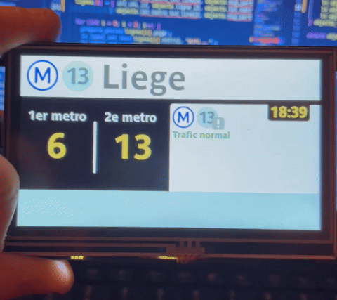
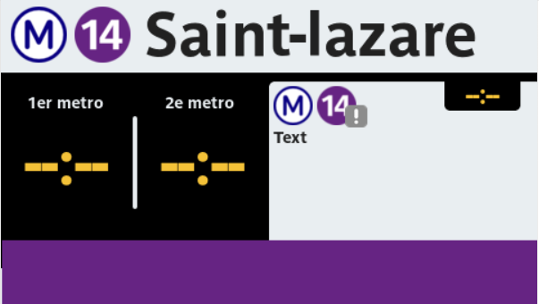

  
# GoToMetro ESP32

Sert a afficher l'heure des 4 prochains métro, il et de base configurer sur l'arret de, Saint-Laz ligne 14 direction Orly.
### Description
La version pour [esp32](https://github.com/Sinayel/gotometroC/tree/main/gotometroesp32) marche avec un [serveur python](https://github.com/Sinayel/gotometroC/blob/main/gotometroesp32/server.py) qui sert a faire une demande GET a l'API de [PRIM](https://prim.iledefrance-mobilites.fr/en/aide-et-contact/documentation/generale/ressources) IDF, parce que l'esp32 s3 accepte uniquement les modes TLS 1.2 et anterieur alors que l'API de PRIM n'accepte
que le TLS 1.3 c'est pourquoi le serveur python sert de pont entre les 2.

pour la version [esp32](https://github.com/Sinayel/gotometroC/tree/main/gotometroesp32) commencer par :
| PC (libcurl) | ESP32 (Arduino)     |
| :-------- | :------- |
| `curl_easy_init()` | `HTTPClient http;` |
| `CURLOPT_URL` | `http.begin(client, url)` |
| `curl_slist_append("apikey: …")` | `http.addHeader("apikey", "…")` |
| `curl_easy_perform()` | `http.GET()` |
| `save + reponse[]` | `http.getString()` |
| `strstr / printf` | `identique (Serial.printf)` |

(1) HTTPClient http -> (2) http.begin(client, url) -> (3) http.addHeader("apikey", "…") -> (4) http.GET() -> (5) http.getString() -> (6) Serial.printf(s + 9, s + 13)

(j'ai aussi fais une [version en C](https://github.com/Sinayel/gotometroC/blob/main/srcs/gotometroEsp32.c))

## Presentation

## Documentation

[libcurl](https://curl.se/libcurl/) Bibliotheque pour faire des requêtes GET
\
[Navitia PRIM (Playground)](https://prim.iledefrance-mobilites.fr/playground/index.html) API de jeu pour tout le reseau IDF
\
[Documentation PRIM](https://prim.iledefrance-mobilites.fr/en/aide-et-contact/documentation/generale/ressources) Docs de PRIM
\
[Eez studio](https://www.envox.eu/studio/studio-introduction/) App pour faire des design graphique
\
[Jq](https://pypi.org/project/jq/) Library for extract and read, filter JSON data